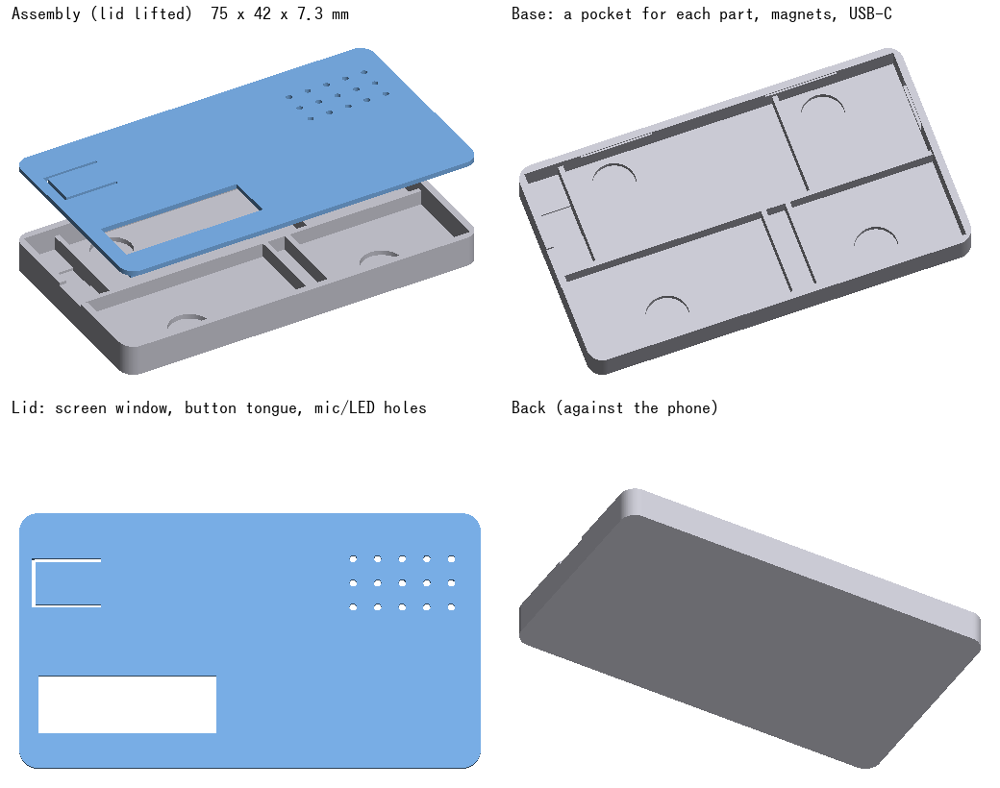

# Enclosure

A thin slab for the recorder that sticks to the back of a phone with MagSafe:
75 × 42 × 7.3 mm.



`enclosure.py` builds it (`pip install build123d`, then `python enclosure.py`) and writes
`base.stl` and `lid.stl`. The part sizes at the top are measured; change any of them and run it
again.

## Layout

Everything lies side by side in one layer, each part in its own pocket, so nothing needs glue:

```
+----------------------------------------------+
| button | battery              | XIAO     USB-C>
|--------+----------------------+--------------|
| OLED (glass up)          | SD module          |
+----------------------------------------------+
```

- **Pockets** fit each part with 0.2 mm to spare. Their walls are 3 mm high, lower than the
  parts, so the wires run over them.
- **The lid snaps on**: bumps on its lip click into grooves in the long walls, and it presses
  every part down. A notch at the button end lets a fingernail lift it.
- **The button** is a tongue cut into the lid. Pressing it pushes a nub onto the switch. The
  switch sits a little lower in the floor so its plunger ends just under the nub.
- **Holes over the XIAO** let its mic hear and its LEDs show (the recording light must be
  visible). The OLED shows through its window.
- **Magnets**: four 8 × 1 mm discs in the floor, on the MagSafe ring, flush with the floor so the
  parts lie on them. 0.5 mm of plastic between them and the phone.

## Printing

- PETG or PLA, 0.2 mm layers (0.1 mm for the lid makes the tongue and snaps nicer), no supports.
- Base flat on the bed; lid outside face down.
- Print the lid first and try it on: if the snaps are too tight or loose, change `SNAP`.

## Assembly

1. Before putting each magnet in, hold it to the phone and mark the side that pulls. Put all
   four in with that side down. They are a press fit; a tiny drop of glue if one is loose.
2. Parts into their pockets, OLED glass up, the XIAO's USB-C against its opening.
3. Snap the lid on.

Parts: 8 × 1 mm N52 disc magnets. Without MagSafe on the phone, a MagSafe ring sticker on the
phone or its case.
